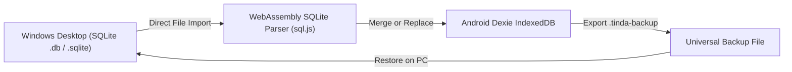

<div align="center">


# 📱 TINDA POS Mobile & Tablet (Android)

**Offline-first Point-of-Sale, Inventory Management & Universal Desktop Migration System for Philippine Sari-Sari Stores, Minimarts, Groceries, and MSMEs.**

### v4.1.3 Stable · Universal Desktop Migration & VIP Security Edition

[-3DDC84?style=for-the-badge&logo=android&logoColor=white)](https://github.com/Yazerukun/TINDA-POS-Android-Free/releases/latest)
[](https://github.com/Yazerukun/TINDA-POS-Android-Free/releases/tag/v4.1.3)
[-F59E0B?style=for-the-badge&logo=sqlite&logoColor=white)](#100-offline-and-data-sovereignty)
[](#development--source-build)
[](#license)

<br/>

[📥 **Download Release APK (v4.1.3)**](https://github.com/Yazerukun/TINDA-POS-Android-Free/releases/download/v4.1.3/TindaPOS-Free-4.1.3.apk) &nbsp;•&nbsp; 
[📖 **User Manual**](release-docs/USERMANUAL.md) &nbsp;•&nbsp; 
[🚀 **Release Notes**](https://github.com/Yazerukun/TINDA-POS-Android-Free/releases/tag/v4.1.3) &nbsp;•&nbsp; 
[🐛 **Report an Issue**](https://github.com/Yazerukun/TINDA-POS-Android-Free/issues)

---

</div>

## 🏪 Your Store Counter in Your Pocket

**TINDA POS Mobile** delivers a complete, professional retail counter workflow to Android smartphones, handheld POS terminals, and tablets. Ring up cash and electronic sales, monitor real-time stock levels, record customer credit (*utang*), direct-print to 58mm/80mm Bluetooth thermal printers, audit petty cash movements, and perform shift closing (*Z-Read*) — **without requiring an internet connection, monthly subscription, or cloud account**.

Everything lives directly on your Android device. Your store data is 100% yours, always fast, and completely safe from internet downtime.

---

## ⚡ What's New in v4.1.3 (Universal Desktop Migration & VIP Edition)

| Feature / Advancement | What it delivers to your business |
| :--- | :--- |
| 🔄 **Desktop SQLite Migration Engine** | Direct in-app parser using WebAssembly SQLite (`sql.js`). Import Windows desktop database files (`.db`, `.sqlite`, `.sqlite3`) and `.tinda-backup` files directly on Android with 1 tap. |
| 💎 **VIP Pro Cryptographic Licensing** | Offline HMAC-SHA256 license key authentication with deterministic hardware machine ID (`TNDA-XXXX-XXXX-XXXX-XXXX`), in-app QR code generator, and instant camera scanning. |
| 🛡️ **Native Hardware Security Plugin** | Android APK certificate fingerprint pinning (`TindaSecurityPlugin.java`), anti-repackaging verification, and root/tamper defense-in-depth protection. |
| 💵 **Petty Cash & Drawer Movements** | Dedicated drawer tracking for Cash In (*Dugang Sukli*) and Cash Out (*Kuha Pang-gasto*) with live shift formula reconciliation. |
| 🏷️ **Wholesale Pricing Tiering** | Automatic unit price reduction to wholesale rates when cart items meet or exceed minimum quantity thresholds. |
| ⚠️ **Shelf-Life & Expiration Badges** | Visual real-time alerts for Near-Expiry (within 7 days) and Expired stock, plus an instant "Expiring" inventory filter. |
| 📋 **Itemized Utang Ledger & Reminders** | Expandable customer credit ledger showing item breakdowns, 1-tap Bluetooth charge slip printing, and formatted SMS/Messenger reminder sharing. |
| 📱 **Dynamic GCash & Maya QR Modal** | Clean phone-to-phone QR code checkout with exact order total and 1-tap "Copy Amount" for zero cashier mistakes. |
| 🧪 **120/120 Automated Vitest Tests** | 100% test pass rate across 18 test suites covering migration, licensing, transactions, accounting, and security. |

---

## 📥 Download & Installation

Download the official signed release package directly to your Android device:

| File | Size | SHA-256 Checksum | Target Platform |
| :--- | :--- | :--- | :--- |
| [**`TindaPOS-Free-4.1.3.apk`**](https://github.com/Yazerukun/TINDA-POS-Android-Free/releases/download/v4.1.3/TindaPOS-Free-4.1.3.apk) | 6.25 MB | `b1d6d9b4727f02ce3f0fd6db3753fa8ddd2064df386e0c73d4a3decb7c645de5` | Android 7.0+ (Phones, Tablets & Handheld POS) |

> [!TIP]
> **Data Preservation on Upgrades:** Installing this update over an existing installation **preserves all your sales history, inventory, customer utang, and settings**. All official releases are signed with our persistent release keystore.

### System Requirements
* **Operating System:** Android 7.0 (Nougat, API 24) or higher (tested up to Android 15).
* **RAM:** 2 GB minimum (optimized for smooth operation on budget Android devices).
* **Storage Space:** ~25 MB free storage.
* **Peripherals (Optional):** Bluetooth 4.0+ for ESC/POS thermal printers, rear camera for barcode scanning.

---

## 🔄 Universal Desktop <-> Android Migration Engine

Switching between your desktop computer and Android phone or tablet has never been easier:



1. Copy your desktop database (`tinda.db`, `.sqlite`, or `.tinda-backup`) to your phone (via USB, Bluetooth, Google Drive, or SD card).
2. In TINDA POS Mobile, open **Settings → Data → Import Desktop Database**.
3. Choose **Merge / Update** (preserves existing mobile sales and adds desktop products/prices) or **Full Replace**.
4. The WebAssembly SQLite engine inspects the file, presents record totals, and completes migration within seconds.

---

## 🛠️ Complete Feature Matrix

```
┌────────────────────────────────────────────────────────────────────────┐
│                      TINDA POS ANDROID CAPABILITIES                    │
├────────────────────────────────┬───────────────────────────────────────┤
│ 🛒 Counter & Cashiering        │ 📦 Inventory & Stock Control          │
│ • Fast product search & pills  │ • Real-time stock decrement           │
│ • Barcode camera scanner       │ • Wholesale tiering thresholds        │
│ • Hold & Resume carts          │ • Expiration date alerts & filters    │
│ • Cash, GCash, Maya, Utang     │ • Low stock warning indicators        │
│ • Custom change calculator     │ • CSV product export and import       │
├────────────────────────────────┼───────────────────────────────────────┤
│ 📋 Customer Credit (Utang)     │ 💵 Shift Reconciliation & Cash Drawer │
│ • Customer balance ledger      │ • Cash Count (bills & coins breakdown)│
│ • Itemized debt breakdown      │ • Petty Cash In / Cash Out drawer logs│
│ • Charge slip thermal printing │ • X-Read (Interim shift audit)        │
│ • SMS & Messenger reminders    │ • Z-Read (Shift closing report)       │
├────────────────────────────────┼───────────────────────────────────────┤
│ 🖨️ Hardware & Thermal Printers │ 🔐 Security & Data Sovereignty        │
│ • ESC/POS Bluetooth (58mm/80mm)│ • 100% Offline IndexedDB persistence  │
│ • Auto-print on checkout       │ • Triple-vault configuration storage  │
│ • Custom receipt headers       │ • Native APK signature pinning        │
│ • Digital shareable receipt    │ • Universal cross-platform backup     │
└────────────────────────────────┴───────────────────────────────────────┘
```

---

## 🖨️ Bluetooth Thermal Printer Setup Guide

Printing receipts on 58mm or 80mm mobile thermal printers:

1. **Turn on & Pair:**
   - Power on your Bluetooth thermal printer.
   - Pair it in your Android Bluetooth settings (standard PIN is `0000` or `1234`).
2. **Configure in App:**
   - Go to **More → Settings → Printer**.
   - Tap your paired printer from the list.
   - Select your paper width (**58mm** or **80mm**).
   - Tap **Test Print** to verify paper alignment and font rendering.
3. **Automatic Printing:**
   - Turn on **Auto-print after sale** to print customer receipts automatically upon checkout.

---

## 💰 Shift Closing Protocol: Cash Count First, Then Z-Read

Maintain strict audit discipline and prevent drawer shorting at the end of every cashier shift:


1. Finish all pending transactions and log any remaining petty cash movements.
2. Navigate to **Reports → Cash Count** while the shift is open.
3. Enter the exact count of each bill (₱1000 down to ₱20) and coin (₱20 down to 25¢).
4. Tap **Save Cash Count**.
5. Navigate to **Reports → Z-Read**, verify drawer variance (*Over / Short*), and tap **Close Shift & Print**.

---

## 🔒 100% Offline and Data Sovereignty

* **Zero Cloud Dependency:** All business records live strictly in local IndexedDB storage managed by [Dexie.js](https://dexie.com/).
* **Zero Telemetry:** No sales figures, customer names, product lists, or phone numbers are ever sent to external cloud servers.
* **Universal Backup:** Export `.tinda-backup` files directly to your phone's Download folder, SD card, or chat share sheet at any time.

---

## 💻 Development & Source Build

TINDA POS Mobile is built with **React 19**, **TypeScript**, **Tailwind CSS**, **Capacitor 8**, **Dexie.js**, and **sql.js WASM**.

### Build Environment
* Node.js 20+
* JDK 17 or JDK 21 (Temurin / OpenJDK)
* Android SDK 34+
* Gradle 8.14+

### Build Steps

```bash
# 1. Install dependencies
npm install

# 2. Run automated test verification (120 tests across 18 test suites)
npm test

# 3. Compile optimized production web bundle
npm run build

# 4. Sync web assets into native Android shell
npx cap sync android

# 5. Build signed release APK
cd android && ./gradlew assembleRelease
```

The compiled release APK is output to:
`android/app/build/outputs/apk/release/app-release.apk`

---

## ☕ Support Philippine Small Businesses & MSMEs

TINDA POS is an independent grassroots software project dedicated to modernizing Philippine sari-sari stores, minimarts, and market stalls with enterprise-grade offline tools.

* **Developer:** Francis Ian Muyco
* **Maya Donation / VIP Pro Lifetime:** `0991 225 5156` (₱500 one-time)
* **Facebook:** [fb.com/Ukauru](https://www.facebook.com/Ukauru)

---

## 📄 License

Proprietary. **Free to use for personal and small retail business operations in the Philippines.** Redistribution, commercial repackaging, or unauthorized rebranding without explicit permission is strictly prohibited.
